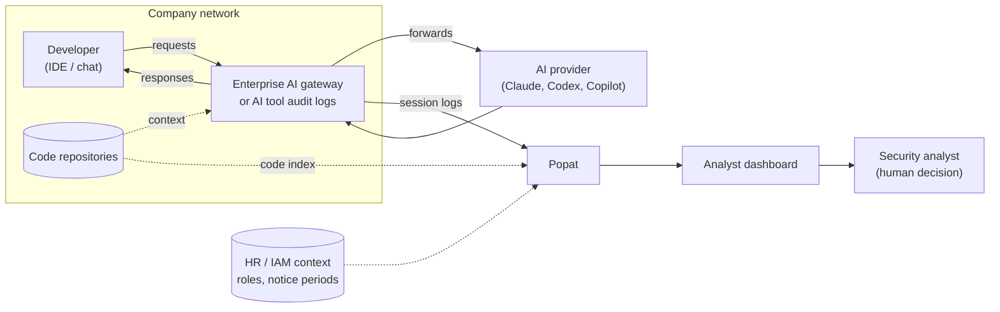
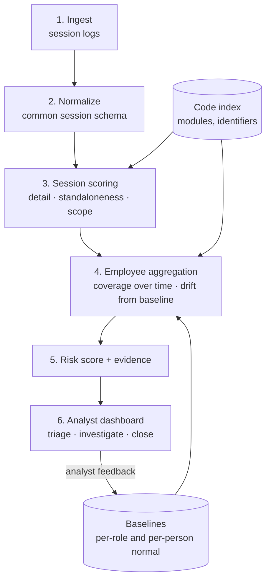

# Architecture

> Design document. Components marked *(planned)* are not built yet.

## Where detection sits

**Why the AI-interaction layer?** Once the AI's answer is on screen, it can leave through copy-paste, a personal phone or a photo, and network DLP will not see it. The request and the response, however, always pass through the AI gateway or the tool's audit log. That is the one point every path shares.

| Deployment option | Pros | Cons |
|---|---|---|
| Enterprise AI gateway / proxy | Sees every request and response; works across vendors | Must be deployed and kept in the request path |
| Vendor admin / audit logs | No traffic interception; easy to start | Depends on what each vendor logs; may be delayed |
| IDE plugin telemetry | Rich context (open files, edits) | Per-IDE work; easier for users to disable |

## Pipeline

1. **Ingest:** collect AI session records (request, response, files in context, time, user ID).
2. **Normalize:** convert each vendor's format into one schema; pseudonymize user IDs.
3. **Session scoring:** estimate how much standalone implementation detail a single interaction revealed and which parts of the codebase it touched.
4. **Employee aggregation:** combine sessions over a rolling window. Splitting activity across many small sessions does not lower the combined total. Compare against role norms and the person's own history.
5. **Risk score + evidence:** a 0–100 score with the top contributing factors in plain language.
6. **Analyst dashboard:** a human reviews, investigates and closes cases. Analyst decisions feed back to reduce false alarms.

## Design principles

- **Human in the loop:** Popat flags; people decide. No automatic blocking or disciplinary action.
- **Explainable:** every score comes with the factors that produced it.
- **Low false alarms first:** onboarding, documentation and handoff work must not drown analysts in alerts.
- **Privacy by design:**
  - pseudonymous IDs by default; re-identification only when a case is opened
  - store derived features rather than raw conversation text where possible
  - role-based access and audit logs for analysts
  - retention limits and employee notice, in line with India's DPDP Act, 2023

## Known limits

- An insider who rebuilds a project purely from memory, without using the AI tool, is out of scope.
- Very slow activity that stays inside a person's normal work area is hard to separate from normal work.
- Popat makes theft slower, more partial and more likely to leave evidence. It does not claim perfect detection.
